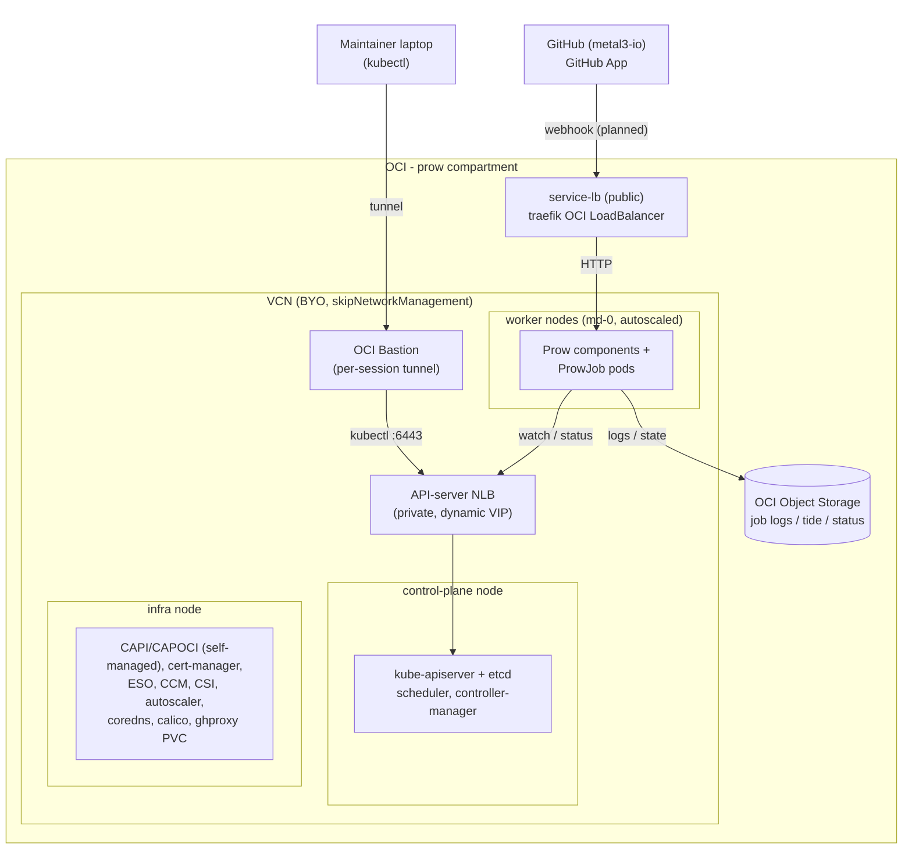

<!-- cSpell:ignore CAPOCI OCID OCIDs capoci ocicluster ocimachinetemplates -->
<!-- cSpell:ignore blockvolume oraclecloud objectstorage compat clusterctl -->
<!-- cSpell:ignore kubeadm kubelet vxlan externalsecret secretgenerator -->
<!-- cSpell:ignore provisioner idknxc eu-paris metal3ci coreprovider -->
<!-- cSpell:ignore ocid ocid1 kubeconfig NLBs NLB nodeSelector datasource -->
<!-- cSpell:ignore writeups -->
<!-- cSpell:ignore ghproxy finalizers paravirtualized oraclevd oci-storage -->
<!-- cSpell:ignore cherrypicker horologium -->

# Prow on Oracle Cloud (OCI)

This directory holds the Metal3 Prow cluster infrastructure on Oracle Cloud
(OCI), built with the Cluster API Provider for Oracle Cloud (**CAPOCI**). It
replaces the earlier OpenStack-based Prow (the `prow/` root: `capi/`,
`capo-cluster/`, `cluster-resources/`, `infra/`, `bootstrap/calico/`).

This README is the overview: architecture, what runs where, the manifest layout,
credentials, and the known gotchas. For the step-by-step deploy, see
[`DEPLOY.md`](./DEPLOY.md). For maintainer kubectl access, see
[`BASTION.md`](./BASTION.md).

## Architecture

The control plane is **self-managed**: after the initial kind-based bootstrap,
CAPI/CAPOCI is pivoted into the workload cluster, which then manages its own
`Cluster`/`Machine` objects. The bootstrap kind VM is discarded after the pivot;
maintainers reach the private API endpoint through the OCI Bastion service.

## What runs where

Workloads are pinned by node role (`node-role.kubernetes.io/infra`,
`node-role.kubernetes.io/control-plane`, and default workers).

| Node role | What runs there |
|-----------|-----------------|
| control-plane | `kube-apiserver`, `etcd`, scheduler, controller-manager |
| infra | the self-managed CAPI/CAPOCI controllers and cert-manager; cluster add-ons: External Secrets Operator, OCI cloud controller manager, Block Volume CSI controller, cluster-autoscaler, CoreDNS, traefik; the `ghproxy` PVC lives here |
| worker (md-0) | Prow components (deck, hook, crier, tide, horologium, sinker, prow-controller-manager, needs-rebase, cherrypicker, copilot-review) and the ProwJob pods they schedule |

Remaining before go-live: wire the GitHub App webhook and point DNS for the
hostname `prow-oci.apps.test.metal3.io` at the traefik load balancer so the
Let's Encrypt certificate issues.

## Layout

| Folder | Purpose |
|--------|---------|
| `capi/` | CAPOCI provider install (cert-manager, cluster-api-operator, Core/Bootstrap/ControlPlane providers, OCI `InfrastructureProvider`) |
| `cluster/` | Workload cluster: `OCICluster`, `OCIMachineTemplate`s, Cluster, KubeadmControlPlane/ConfigTemplate, MachineDeployments |
| `cluster-resources/` | OCI cloud controller manager, Block Volume CSI (+ VolumeSnapshot CRDs), cluster-autoscaler |
| `calico/` | Calico CNI, VXLAN encapsulation (IP-in-IP is fragile on OCI) |
| `infra/` | OCI StorageClass, traefik (OCI LoadBalancer), cert-manager issuers, certificate |

Each folder is a standalone kustomization (no cross-folder references) so it
builds under `kubectl apply -k`. The shared `../bootstrap` (ESO, ClusterSecretStore)
is reused from the `prow/` root.

## Credentials

Two modes, toggled in `capi/kustomization.yaml` and
`cluster-resources/kustomization.yaml`:

- **1Password / ESO (default):** `externalsecret.yaml` syncs the secrets from
  the vault items below via External Secrets Operator. Requires ESO installed on
  the cluster, the `onepassword` ClusterSecretStore, and the ESO 1Password
  service-account token seeded once (`onepassword-prow-service-account` in the
  `external-secrets` namespace).
- **Local secrets (fallback, for testing without 1Password):** comment out
  `externalsecret.yaml`, uncomment the `secretGenerator` block, and provide the
  local gitignored files `capi/oci-variables.env` and
  `cluster-resources/prow-cloud-provider.yaml`. Copy the `*.example` files and
  fill them in (the `oci-variables.env.example` header lists the exact `base64`
  commands).

OCIDs and bucket names are identifiers, not secrets, and are committed in the
manifests. Only credentials (API key, S3 secret key, tokens) stay out of git.

### 1Password `prow-oci-credentials` item

Credentials belong to the dedicated, least-privilege `prow-ci` OCI user (group
`prow-ci`, policy `prow-ci-policy` scoped to the `prow` compartment) - never the
tenancy-admin user. The `prow-oci-credentials` item has these fields, consumed
by CAPOCI (`prow-oci/capi`):

| Field | Value |
|-------|-------|
| `tenancy_id_b64` | base64(tenancy OCID) |
| `user_id_b64` | base64(prow-ci user OCID) |
| `fingerprint_b64` | base64(API key fingerprint) |
| `region_b64` | base64("eu-paris-1") |
| `api_key_b64` | base64(prow-ci private key PEM) |
| `use_instance_principal_b64` | base64("false") |

The CCM/CSI `cloud-provider.yaml` is a **separate** 1Password item (referenced
by `prow-oci/cluster-resources/externalsecret.yaml`). It holds the complete CCM
config: the auth block plus `compartment`, `vcn`, and `loadBalancer.subnet1`.

> NOTE - BYO network: the VCN and subnets are fixed, not created per cluster.
> `ocicluster.yaml` sets `skipNetworkManagement: true`, so CAPOCI never creates
> or deletes the VCN/subnets - it only creates the API-server NLB. The VCN and
> `service-lb` subnet OCIDs are therefore STABLE and already hardcoded in
> `cluster/ocicluster.yaml`. Set `vcn` and `loadBalancer.subnet1` in
> `cloud-provider.yaml` once, to those same OCIDs; they do NOT change on a
> cluster rebuild, so there is no post-provision discovery step.

## Deploy

Step-by-step runbook: [`DEPLOY.md`](./DEPLOY.md).

Run every command from `prow-oci/` (kustomize paths are bare). Expect to apply
the CAPI manifests a few times as CRDs and webhooks come up - that is normal.

## Teardown

Re-pivot to kind, delete the CCM load balancer, then delete the cluster - with
the BYO VCN left intact. The full sequence and its ordering gotchas are in
[`TEARDOWN.md`](./TEARDOWN.md).

## Notes

Several non-obvious issues (node-image requirements, provider-id, the Calico
VXLAN NSG rule, image pinning, the CSI secrets, and more) are already handled in
these manifests. The maintainer notes that explain each are kept out of this
overview; they live with the migration write-ups.
